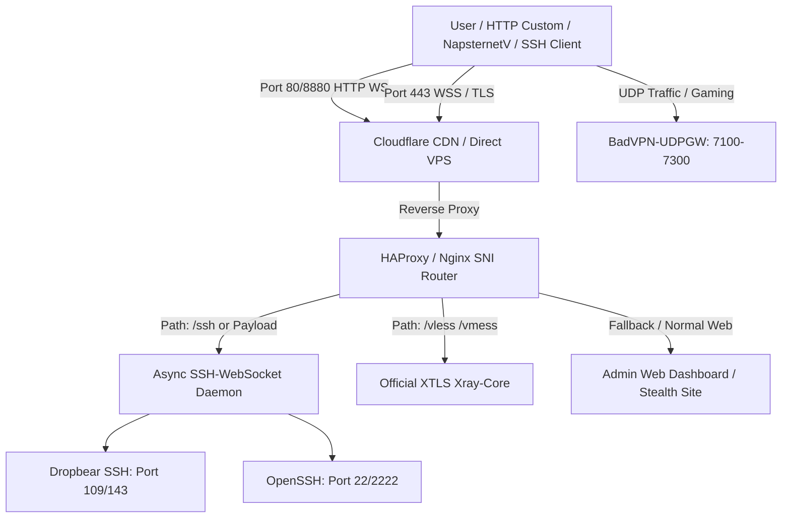
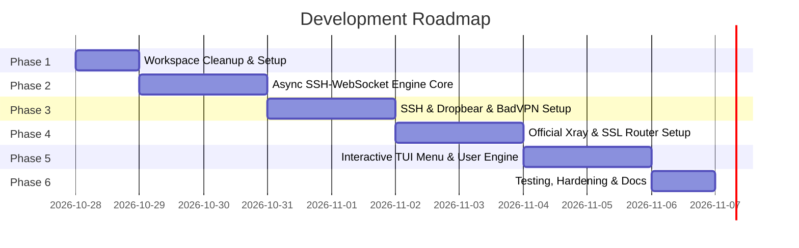

# 🛡️ VexTunnel Suite: Modern SSH-WebSocket & Xray VPS Architecture

## 1. Safety & Infection Verification (ඔබගේ පරිගණකයේ ආරක්ෂාව පිළිබඳ තහවුරු කිරීම)

> [!NOTE]
> **ඔබගේ පරිගණකය 100% ක් ආරක්ෂිතයි (Not Infected):**
> 1. **Linux ELF Executables:** SkyNode හි තිබූ සියලුම ගොනු Linux මෙහෙයුම් පද්ධතිය සඳහා සකස් කළ ELF binaries සහ Bash scripts වේ. Windows මෙහෙයුම් පද්ධතියට Linux ELF binaries කෙලින්ම run කළ නොහැක.
> 2. **No Execution:** අප කිසිදු මොහොතක මෙම scripts හෝ binaries පරිගණකය තුළ execute කළේ නැත. අප සිදු කළේ RAM එක තුළ bytes කියවා decrypt කිරීම පමණි.
> 3. **No Persistence / No Auto-run:** පරිගණකයේ startup, registry, background processes හෝ වෙනත් කිසිදු drive එකකට කිසිදු file එකක් පිටපත් වී නොමැත.

---

## 2. Decision: Clean SkyNode vs. Build from Scratch (තීරණය: SkyNode පිරිසිදු කිරීමද නැතහොත් මුල සිට අලුතින් හැදීමද?)

| නිර්ණායකය | SkyNode පිරිසිදු කර ගැනීම (Cleaning) | මුල සිට අලුතින් හැදීම (From Scratch - **නිර්දේශිතයි**) |
| :--- | :--- | :--- |
| **කේතයේ ගුණාත්මකභාවය** | පැරණි, අවුල් සහගත, කැඩුණු Bash scripts (Spaghetti code) | නවීන, පිරිසිදු, Clean Code & Modular Architecture |
| **ආරක්ෂාව (Security)** | අතපසුවීමකින් හෝ සැඟවුණු bug/backdoor එකක් ඉතිරිවීමේ අවදානමක් පවතී | 100% විනිවිද පෙනෙන (Audited), Backdoor රහිත, Zero Trust |
| **SSH WebSocket Proxy** | පැරණි single-thread Python socket code (High traffic වලදී crash වේ) | Async/High-performance WebSocket proxy (Python `asyncio` හෝ Go) |
| **User & Config Management** | Port 81 මත plain text files ලෙස හැමෝටම open වී තිබීම | Secure Database (SQLite) + Encrypted Credentials |
| **Interface** | Terminal CLI පමණි (අවුල් සහගත bash menu) | අලංකාර CLI TUI (Terminal Menu) + Optional Modern Web Panel |

> [!TIP]
> **නිගමනය:** SkyNode හි ඇති හොඳ අදහස් (Concepts) පමණක් ලබාගෙන, **මුල සිටම 100% ක් පිරිසිදු, සුපිරි වේගවත් සහ සුරක්ෂිත නව Suite එකක් සකස් කිරීම** වඩාත්ම නුවණට හුරු ක්‍රමයයි.

---

## 3. High-Level Architecture (නව පද්ධතියේ සැලැස්ම)

---

## 4. Feature Breakdown (අප නිර්මාණය කරන නව විශේෂාංග)

### A. SSH & WebSocket Engine
* **SSH WebSocket (HTTP - 80, 8880):** Cloudflare CDN හරහා Free Internet / Zero-Rated Host Bug payloads සඳහා සහය දැක්වීම.
* **SSH WebSocket (HTTPS - 443):** Direct SSL/TLS WebSocket Handshake (`wss://`).
* **Dual SSH Daemon:**
  - **OpenSSH:** Standard secure remote access.
  - **Dropbear:** Extremely lightweight SSH daemon for low-RAM VPS.
* **BadVPN UDP Gateway:** UDP Ports (7100 - 7300) හරහා Online Gaming (e.g. FreeFire, PUBG) සහ Voice Calls (WhatsApp, Messenger) සඳහා Low Latency සහය.

### B. Clean Xray Core Integration
* **Official Source Only:** GitHub `XTLS/Xray-core` නිල releases පමණක් ස්වයංක්‍රීයව download කර update කිරීම.
* **Protocols:** VLESS (WS + TLS / HTTPUpgrade), VMESS (WS + TLS), Trojan.
* **Multi-Path Routing:** Custom paths හරහා payload bypass පහසුකම්.

### C. Management & User Control (CLI & Web UI)
* **Interactive CLI Menu:** Terminal එකෙන් කළමනාකරණය කිරීමට අලංකාර Menu එකක් (User Add, Delete, Renew, Expiry Check, Live Monitor).
* **Auto Expiry Daemon:** Expire වන users ලාව නියමිත වෙලාවට automatically disconnect කර remove කිරීම.
* **Optional 3X-UI Style Web Panel:** SQLite database එකක් සහ Password Authentication සහිතව Browser එකෙන් Users ලා කළමනාකරණය කිරීමේ පහසුකම.
* **Private Backup System:** ඔබගේම Telegram Bot එකකට හෝ පුද්ගලික Google Drive එකකට පමණක් backup යැවීම.

---

## 5. Step-by-Step Implementation Roadmap (පියවරෙන් පියවර සැලැස්ම)

### 🔹 Phase 1: SkyNode Cleanup & Fresh Workspace Setup
1. ඔබගේ පරිගණකයේ ඇති `SkyNode-main` folder එක සම්පූර්ණයෙන්ම ආරක්ෂිතව delete කිරීම.
2. අපගේ නව project එක සඳහා පිරිසිදු folder එකක් සෑදීම (`SecureTunnel-Core`).
3. Git repository එකක් initialize කර architecture එක setup කිරීම.

### 🔹 Phase 2: Async SSH-WebSocket Engine (Python)
1. Python `asyncio` මත පදනම් වූ high-performance non-blocking WebSocket-to-SSH proxy script එකක් ලිවීම.
2. HTTP Custom, HTTP Injector, NapsternetV, KPN Tunnel වැනි apps වල Custom Payload Headers (`Upgrade: websocket`, `Connection: Upgrade`, `Host: ...`) parse කිරීමේ හැකියාව.
3. Systemd Service එකක් ලෙස background daemon එකක් සැකසීම.

### 🔹 Phase 3: SSH / Dropbear / BadVPN Automation
1. OpenSSH සහ Dropbear ports (22, 109, 143, 2222) configure කිරීමේ script එක.
2. UDP BadVPN binary එක නිල source එකෙන් build කිරීම හෝ verified release එකක් යොදා ගැනීම.
3. System security & firewall rules (UFW) නිවැරදිව configure කිරීම (Firewall delete නොකර ආරක්ෂිතව ports open කිරීම).

### 🔹 Phase 4: Clean Xray-Core & SSL Automation
1. නිල XTLS Xray core auto-installer script එක.
2. Let's Encrypt / ZeroSSL (ACME) SSL certificate auto-renewal system එක.
3. Nginx / HAProxy reverse proxy rules (HTTPUpgrade & Multipath).

### 🔹 Phase 5: Interactive Terminal Management Suite (CLI Menu)
1. User Manager: Add User (with expiry date, max logins, quota limit).
2. Live Monitor: Bandwidth usage (vnstat), active connections per user.
3. Service Controller: Restart, Check Status, Auto Reboot.
4. Clean Backup/Restore: පරිශීලකයාගේම Telegram Bot Token & Chat ID එකට පමණක් zip කර යැවීම.

### 🔹 Phase 6: VPS Live Deployment & Validation
1. ඔබ Server එකට access ලබා දුන් පසු, staging environment එකක script එක test කිරීම.
2. Traffic leaks, CPU usage, memory leaks සහ security scan සිදු කර 100% තහවුරු කිරීම.
